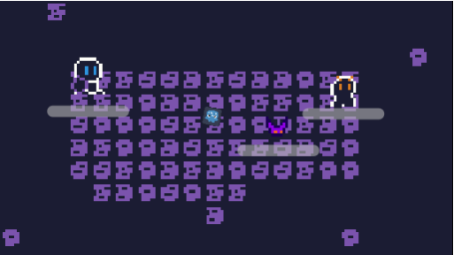

# DungeonWarrior
A simple 8-bit dungeon game made in godot for hackclub thirdspace by 2 people

## How to play
Access the live demo at https://renan-g.itch.io/dungeonwarrior :)

## Input
- WASD and arrow keys moves the player
- E interacts
- Clicking will trigger attack if you have a weapon

## About
The game is about a little warrior that needs to escape the dungeon where he is. To do that he needs to transit between rooms

## Mechanics
The game have a door system so it can reload the rooms quickly and grab context from where to go.
The game have different types of bullets, and weapons in general. There's a bow and a sword. More will be added.
We have inteligent enemies with raycasting and state machines! 
Theres slimes, chests, bats and shadow enemies to fight

## Notes:
The door have not a sprite. It is invisible as we didn't had time to draw a nice sprite to it.

## How to build
Clone the repo with `git clone https://github.com/Renan-G-projec.git`
Open the folder with godot and click the big run button :p

## AI Disclosure:
NONE AI was used for making the assets. A small amount of AI was used while debugging the game. The drawing time can be seen in https://lapse.hackclub.com/user/@renan